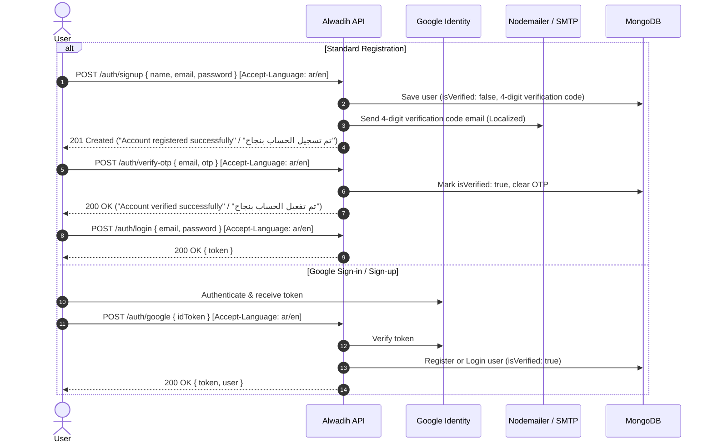
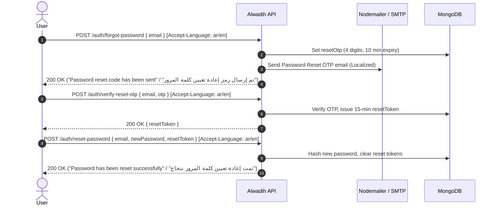

# 🚀 Alwadih Backend API Documentation

Welcome to the **Alwadih Backend API** documentation. This document covers all endpoints for Authentication, Google Sign-in / Sign-up, Account Verification, and Password Reset with **Multilingual Support (Arabic & English)**.

You can import the included Postman collection directly:
📁 **File:** [`postman_collection.json`](./postman_collection.json)

---

## 🌐 Localization & Language Support (`Accept-Language`)

All API endpoints support language selection via the standard HTTP header:

| Header | Supported Values | Default | Description |
| :--- | :--- | :--- | :--- |
| `Accept-Language` | `ar` or `en` *(also accepts `ar-EG`, `ar-SA`, `en-US`)* | `en` | Determines the language of API response messages and outgoing verification emails. |

- If `Accept-Language: ar` is sent: All response messages and verification emails are returned in **Arabic**.
- If `Accept-Language: en` (or omitted): All response messages and verification emails are returned in **English**.

---

## ⚙️ Base URL & Environment Variables

| Variable | Default Value | Description |
| :--- | :--- | :--- |
| `{{base_url}}` | `http://localhost:8000` | Base URL of the API server |
| `{{accept_language}}` | `en` *(toggle between `ar` and `en`)* | Header used in Postman collection |
| `{{jwt_token}}` | Auto-set on login / google auth | Bearer token for authorized requests |
| `{{reset_token}}` | Auto-set on OTP verify | Temporary token used to complete password reset |

---

## 📋 Table of Contents

- [General](#1-general)
  - [Health Check](#health-check)
- [Authentication Flow](#2-authentication-flow)
  - [1. User Registration (Signup)](#1-user-registration-signup)
  - [2. Verify Account OTP](#2-verify-account-otp)
  - [3. Resend Account OTP](#3-resend-account-otp)
  - [4. Register or Login with Google](#4-register-or-login-with-google)
  - [5. Login](#5-login)
- [Password Reset Flow](#3-password-reset-flow)
  - [1. Request Reset OTP (Forgot Password)](#1-request-reset-otp-forgot-password)
  - [2. Resend Reset OTP](#2-resend-reset-otp)
  - [3. Verify Reset OTP](#3-verify-reset-otp)
  - [4. Change Password](#4-change-password)

---

## 1. General

### Health Check
Check if the API server is online.

- **Method:** `GET`
- **URL:** `{{base_url}}/`
- **Headers:** `Accept-Language: en` *(or `ar`)*
- **Response `200 OK` (English):**
  ```text
  Hello World!
  ```
- **Response `200 OK` (Arabic):**
  ```text
  مرحباً بكم في منصة الواضح!
  ```

---

## 2. Authentication Flow



### 1. User Registration (Signup)
Creates a new account, generates a **4-digit verification code**, and emails it to the user in the selected language.

> **Password Policy Requirements:**
> - Minimum length: **10 characters**
> - At least **1 letter** (`a-z`, `A-Z`)
> - At least **1 number** (`0-9`)
> - At least **1 special character** (e.g. `!@#$%^&*()_+-=[]{};':",.<>/?`)

- **Method:** `POST`
- **URL:** `{{base_url}}/auth/signup`
- **Headers:** 
  - `Content-Type: application/json`
  - `Accept-Language: en` *(or `ar`)*
- **Body:**
  ```json
  {
    "name": "John Doe",
    "email": "user@example.com",
    "password": "SecretPass123!"
  }
  ```
- **Response `201 Created`:**
  - **EN:** `{"message": "Account registered successfully. A verification code has been sent to your email."}`
  - **AR:** `{"message": "تم تسجيل الحساب بنجاح. تم إرسال رمز التحقق إلى بريدك الإلكتروني."}`
- **Error Responses (400 Bad Request):**
  - **EN:** `An account with this email address already exists.`
  - **AR:** `يوجد حساب مسجل بالفعل بهذا البريد الإلكتروني.`

---

### 2. Verify Account OTP
Validates the 4-digit verification code and activates the account.

- **Method:** `POST`
- **URL:** `{{base_url}}/auth/verify-otp`
- **Headers:** 
  - `Content-Type: application/json`
  - `Accept-Language: en` *(or `ar`)*
- **Body:**
  ```json
  {
    "email": "user@example.com",
    "otp": "4829"
  }
  ```
- **Response `200 OK`:**
  - **EN:** `{"message": "Account verified successfully."}`
  - **AR:** `{"message": "تم تفعيل الحساب بنجاح."}`
- **Error Responses:**
  - `400 Bad Request` (Invalid):
    - **EN:** `Invalid verification code.`
    - **AR:** `رمز التحقق غير صحيح.`
  - `400 Bad Request` (Expired):
    - **EN:** `Verification code has expired. Please request a new one.`
    - **AR:** `انتهت صلاحية رمز التحقق. يرجى طلب رمز جديد.`
  - `404 Not Found`:
    - **EN:** `Account not found with the provided email.`
    - **AR:** `لم يتم العثور على حساب مسجل بهذا البريد الإلكتروني.`

---

### 3. Resend Account OTP
Generates a new 4-digit code if the previous one expired or was not received.

- **Method:** `POST`
- **URL:** `{{base_url}}/auth/resend-otp`
- **Headers:** 
  - `Content-Type: application/json`
  - `Accept-Language: en` *(or `ar`)*
- **Body:**
  ```json
  {
    "email": "user@example.com"
  }
  ```
- **Response `200 OK`:**
  - **EN:** `{"message": "A new verification code has been sent to your email."}`
  - **AR:** `{"message": "تم إرسال رمز تحقق جديد إلى بريدك الإلكتروني."}`
- **Error Responses (404 Not Found):**
  - **EN:** `Account not found with the provided email.`
  - **AR:** `لم يتم العثور على حساب مسجل بهذا البريد الإلكتروني.`

---

### 4. Register or Login with Google
Authenticates a user via Google/Gmail. If the user does not exist, registers them automatically and marks their account as verified. If they already exist, logs them in.

- **Method:** `POST`
- **URL:** `{{base_url}}/auth/google`
- **Headers:** 
  - `Content-Type: application/json`
  - `Accept-Language: en` *(or `ar`)*
- **Body:**
  ```json
  {
    "idToken": "<GOOGLE_ID_TOKEN_OR_ACCESS_TOKEN>"
  }
  ```
  *(Accepts `idToken`, `token`, or `credential`)*
- **Response `200 OK`:**
  ```json
  {
    "message": "Google authentication successful.",
    "token": "eyJhbGciOiJIUzI1NiIsInR5cCI6IkpXVCJ9...",
    "user": {
      "id": "6724391ab...",
      "name": "Ali Elsese",
      "email": "info.alwadih@gmail.com",
      "avatar": "https://lh3.googleusercontent.com/...",
      "isVerified": true
    }
  }
  ```
  *(In Arabic, `message` returns `"تمت المصادقة عبر جوجل بنجاح."`)*
- **Error Responses:**
  - `400 Bad Request`:
    - **EN:** `Google authentication token is required.`
    - **AR:** `رمز مصادقة جوجل مطلوب.`
  - `401 Unauthorized`:
    - **EN:** `Google authentication failed: token is invalid or expired.`
    - **AR:** `فشلت مصادقة جوجل: الرمز غير صالح أو منتهي الصلاحية.`

---

### 5. Login
Authenticates user credentials and returns a JWT token.  
*(Note: Requires the account to be verified via `/auth/verify-otp` first).*

- **Method:** `POST`
- **URL:** `{{base_url}}/auth/login`
- **Headers:** 
  - `Content-Type: application/json`
  - `Accept-Language: en` *(or `ar`)*
- **Body:**
  ```json
  {
    "email": "user@example.com",
    "password": "SecretPass123!"
  }
  ```
- **Response `200 OK`:**
  ```json
  {
    "message": "Login successful.",
    "token": "eyJhbGciOiJIUzI1NiIsInR5cCI6IkpXVCJ9..."
  }
  ```
  *(In Arabic, `message` returns `"تم تسجيل الدخول بنجاح."`)*
- **Error Responses:**
  - `401 Unauthorized` (Invalid credentials):
    - **EN:** `Invalid email or password.`
    - **AR:** `البريد الإلكتروني أو كلمة المرور غير صحيحة.`
  - `401 Unauthorized` (Not verified):
    - **EN:** `Account is not verified. Please verify your email before logging in.`
    - **AR:** `الحساب غير مفعل. يرجى تأكيد بريدك الإلكتروني أولاً لتسجيل الدخول.`
  - `401 Unauthorized` (Google account):
    - **EN:** `This account was registered using Google. Please sign in with Google or reset your password.`
    - **AR:** `تم تسجيل هذا الحساب عبر جوجل. يرجى تسجيل الدخول عبر جوجل أو طلب إعادة تعيين كلمة المرور.`

---

## 3. Password Reset Flow



### 1. Request Reset OTP (Forgot Password)
Sends a 4-digit reset code to the user's email.

- **Method:** `POST`
- **URL:** `{{base_url}}/auth/forgot-password`
- **Headers:** 
  - `Content-Type: application/json`
  - `Accept-Language: en` *(or `ar`)*
- **Body:**
  ```json
  {
    "email": "user@example.com"
  }
  ```
- **Response `200 OK`:**
  - **EN:** `{"message": "Password reset code has been sent to your email."}`
  - **AR:** `{"message": "تم إرسال رمز إعادة تعيين كلمة المرور إلى بريدك الإلكتروني."}`
- **Error Responses (404 Not Found):**
  - **EN:** `No account found with this email address.`
  - **AR:** `لم يتم العثور على أي حساب مسجل بهذا البريد الإلكتروني.`

---

### 2. Resend Reset OTP
Resends a new 4-digit code for password reset.

- **Method:** `POST`
- **URL:** `{{base_url}}/auth/resend-reset-otp`
- **Headers:** 
  - `Content-Type: application/json`
  - `Accept-Language: en` *(or `ar`)*
- **Body:**
  ```json
  {
    "email": "user@example.com"
  }
  ```
- **Response `200 OK`:**
  - **EN:** `{"message": "A new password reset code has been sent to your email."}`
  - **AR:** `{"message": "تم إرسال رمز جديد لإعادة تعيين كلمة المرور إلى بريدك الإلكتروني."}`
- **Error Responses (404 Not Found):**
  - **EN:** `No account found with this email address.`
  - **AR:** `لم يتم العثور على أي حساب مسجل بهذا البريد الإلكتروني.`

---

### 3. Verify Reset OTP
Verifies the 4-digit code and returns a temporary `resetToken` valid for 15 minutes.

- **Method:** `POST`
- **URL:** `{{base_url}}/auth/verify-reset-otp`
- **Headers:** 
  - `Content-Type: application/json`
  - `Accept-Language: en` *(or `ar`)*
- **Body:**
  ```json
  {
    "email": "user@example.com",
    "otp": "8392"
  }
  ```
- **Response `200 OK`:**
  - **EN:** `{"message": "Verification code verified successfully. You may now reset your password.", "resetToken": "5f8a29..."}`
  - **AR:** `{"message": "تم التحقق من الرمز بنجاح. يمكنك الآن إعادة تعيين كلمة المرور.", "resetToken": "5f8a29..."}`
- **Error Responses:**
  - `400 Bad Request` (Invalid):
    - **EN:** `Invalid verification code.`
    - **AR:** `رمز التحقق غير صحيح.`
  - `400 Bad Request` (Expired):
    - **EN:** `Verification code has expired. Please request a new one.`
    - **AR:** `انتهت صلاحية رمز التحقق. يرجى طلب رمز جديد.`
  - `404 Not Found`:
    - **EN:** `No account found with this email address.`
    - **AR:** `لم يتم العثور على أي حساب مسجل بهذا البريد الإلكتروني.`

---

### 4. Change Password
Resets the password to `newPassword` using the `resetToken`.

> **Password Policy Requirements:**
> - Minimum length: **10 characters**
> - At least **1 letter** (`a-z`, `A-Z`)
> - At least **1 number** (`0-9`)
> - At least **1 special character** (e.g. `!@#$%^&*()_+-=[]{};':",.<>/?`)

- **Method:** `POST`
- **URL:** `{{base_url}}/auth/reset-password`
- **Headers:** 
  - `Content-Type: application/json`
  - `Accept-Language: en` *(or `ar`)*
- **Body:**
  ```json
  {
    "email": "user@example.com",
    "newPassword": "BrandNewPassword123!",
    "resetToken": "5f8a29b4e1c390..."
  }
  ```
- **Response `200 OK`:**
  - **EN:** `{"message": "Password has been reset successfully. You can now log in with your new password."}`
  - **AR:** `{"message": "تمت إعادة تعيين كلمة المرور بنجاح. يمكنك الآن تسجيل الدخول بكلمة المرور الجديدة."}`
- **Error Responses:**
  - `400 Bad Request` (Expired session):
    - **EN:** `Password reset session has expired or is invalid. Please request a new verification code.`
    - **AR:** `انتهت صلاحية جلسة إعادة تعيين كلمة المرور. يرجى طلب رمز تحقق جديد.`
  - `400 Bad Request` (Invalid token):
    - **EN:** `Invalid or expired reset token.`
    - **AR:** `رمز إعادة التعيين غير صالح أو منتهي الصلاحية.`
  - `404 Not Found`:
    - **EN:** `No account found with this email address.`
    - **AR:** `لم يتم العثور على أي حساب مسجل بهذا البريد الإلكتروني.`
